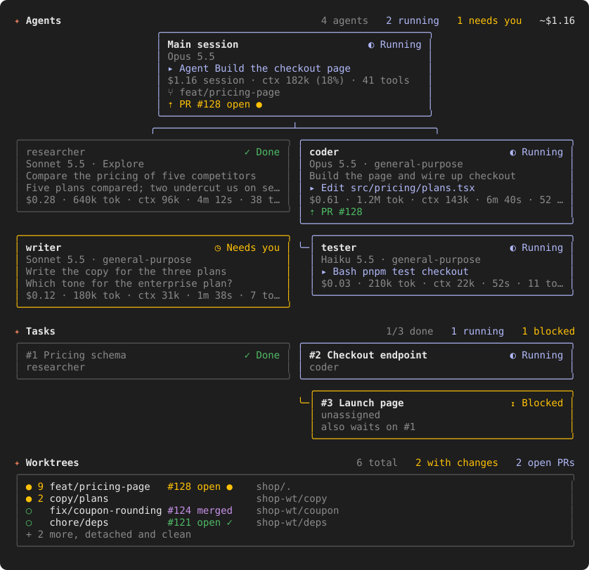

# work-graph

A Claude Code mod that adds a **Work** pane: the agents of the session as an org chart of cards, the tasks with what blocks them, and the git worktrees with their pull requests.



## What it shows

**Agents.** A card for the main session, joined by connector lines to a card per agent, with subagents hanging under their parent. Each card has:

- status: running, starting, needs you, idle, done, error, refused, stopped. An idle teammate shows how its last turn ended.
- model, agent type and the plugin the agent comes from (`Opus 5.5 · poteto-agent · pstack`)
- what it is doing now (`▸ Edit api.ts`), or the first line of its last answer
- estimated cost, tokens, context in use, time spent, tool calls and files edited
- the pull request it opened with `gh pr create`

The header carries the agent counts and the session cost as `/cost` reports it.

**Tasks.** Tasks created with `TaskCreate` as cards, each blocked task under the task that blocks it, with done, running, blocked and ready states.

**Worktrees.** The worktrees with uncommitted changes or a branch of their own, with the number of changed files and the branch's pull request: number, open, draft, merged or closed, and CI checks. Detached and clean worktrees are folded into one line.

## Install

At the prompt of a Claude Code session:

```
/plugin install work-graph --marketplace mariano-aguero/claude-work-graph
```

From a shell:

```
claude plugin install work-graph --marketplace mariano-aguero/claude-work-graph
```

The pane opens by itself when a session starts. `/work` opens it at any time. In a fullscreen terminal at least 110 columns wide it docks beside the transcript; otherwise it sits above the prompt.

## Requirements

- Claude Code with mod support (function hooks).
- `git` for the worktree list.
- `gh`, signed in, for pull requests. Without it the pane shows worktrees without PRs.

## Notes

- Per-agent cost is an estimate: tokens times the model's list price, cache writes at 1.25x input. The header total is the session's own figure.
- Figures count from the moment the mod loads; earlier turns are not seen.
- A teammate running in a terminal pane of its own is a separate process: its card shows its status, not its usage.
- Pull requests are fetched once a minute with a single `gh pr list --author @me`.

## Development

```
claude plugin validate .
claude plugin test .
```

To run a local copy, start a session with `claude --plugin-dir <path to this folder>`.
